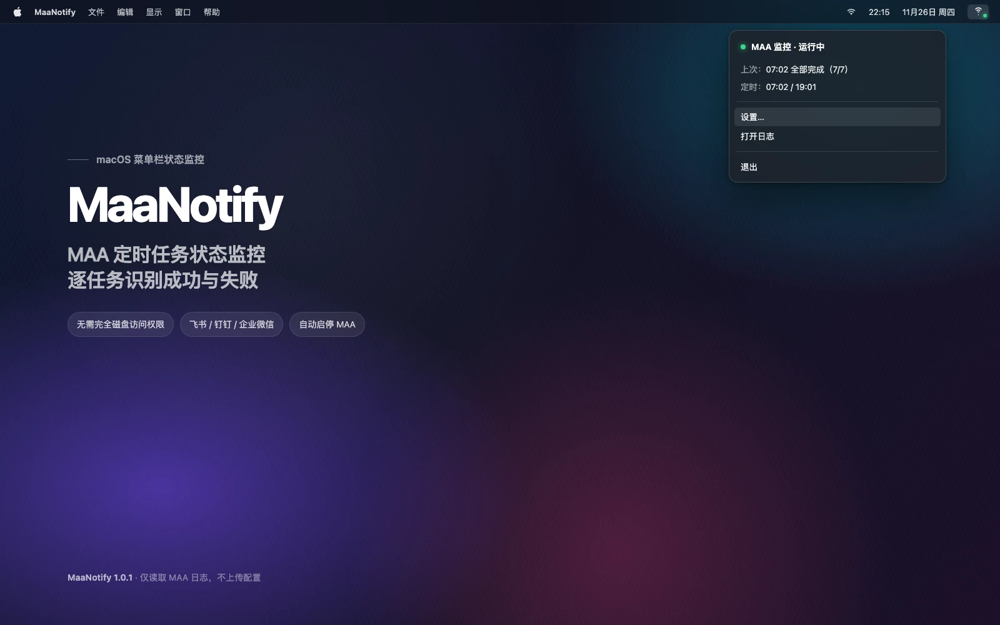

<div align="center">



# MaaNotify

**人不在电脑前，也能知道 MAA 任务跑得怎么样。**<br>
到点拉起 MAA、结束后退出、逐任务判断结果，并推送到手机。

<p>
  
  
  
  <a href="https://github.com/BestJarvan/maa-notify/releases/latest"></a>
  <a href="https://github.com/BestJarvan/maa-notify/actions/workflows/pr-review.yml"></a>
</p>

<p>
  <a href="#快速开始">快速开始</a> ·
  <a href="#功能">功能</a> ·
  <a href="#消息机器人">消息机器人</a> ·
  <a href="#常见问题">常见问题</a> ·
  <a href="#开发与维护">开发与维护</a>
</p>

</div>

---

> **只读 MAA 日志，不需要给 Python 开“完全磁盘访问权限”。**<br>
> 只有你主动开启“自动启停 MAA”时，MaaNotify 才会操作 MAA。

## 为什么需要 MaaNotify

MAA 可以自己按计划跑，但人不在电脑前时，经常遇到这些问题：

- 到点了，MAA 没有启动；
- 任务跑完了，不知道结果；
- 某个任务失败了，还要远程连回 Mac 看日志；
- 跑完后 MAA 一直挂着，还要手动退出。

MaaNotify 补的是这一段：

- 按设定时间由 App 拉起 MAA（可选）；
- 任务结束后自动退出 MAA（可选）；
- 读取 MAA 日志，逐任务判断成功、失败、重试恢复；
- 把失败任务和失败原因整理出来；
- 通过飞书、钉钉、企业微信等机器人推送到手机。

适合这些场景：

- 外出、上班时，MAA 在 Mac 上按计划执行；
- 想第一时间知道有没有任务失败；
- 不想为了看结果专门开远程桌面回电脑；
- Mac 长期挂机、MAA 一直开着：自动退出 + 下次任务前启动，会让 MAA 重新走启动时的更新检查，避免长期不重启一直不触发自动更新。

> MaaNotify 不是云控，不会绕过 MAA 的本地计划。它做的是本地定时拉起、监控和通知。<br>
> Mac 在任务时间需要保持唤醒；睡眠唤醒尚未实现。

## 功能

| 能力 | 说明 |
|---|---|
| 逐任务结果 | 成功、失败、重试后恢复、未执行、超时、取消 |
| 失败原因 | 尽量从 `asst.log` 中提取，例如关卡识别失败 |
| 菜单栏常驻 | 当前状态、上次结果、监控定时 |
| 消息机器人 | 飞书 / Lark、通用 Webhook、Bark、钉钉、企业微信 |
| 消息可选 | 不填机器人也能监控，只是不发送通知 |
| 自动启停 MAA | 任务前启动、结束后退出，可设置提前量和退出延迟 |
| 登录自启 | 开机登录桌面后自动运行 MaaNotify |
| 目录可修改 | 默认 MAA Data 目录，可手动改路径或重新选择 |
| 本地优先 | Webhook 和配置只保存在本机，不上传 |

## 快速开始

### 方式一：DMG（推荐）

1. 打开 [Releases](https://github.com/BestJarvan/maa-notify/releases/latest)，下载 `MaaNotify-1.0.1.dmg`
2. 双击挂载 DMG
3. 双击 `安装.command`
4. 按提示完成安装，菜单栏会出现 MaaNotify 图标

> 当前没有 Apple 开发者签名和公证。从浏览器下载后，macOS 可能提示“无法验证开发者”，右键“打开”或在“系统设置 → 隐私与安全性”里允许一次即可。

### 方式二：ZIP

下载 `MaaNotify-1.0.1.zip`，解压后运行：

```bash
cd MaaNotify-1.0.1
./install_menuapp.sh
```

### 首次配置

第一次打开会要求选择 MAA 的 Data 目录，默认位置是：

```text
~/Library/Containers/com.hguandl.MeoAsstMac/Data
```

确认目录后：

1. 打开设置窗口；
2. 需要推送时填写消息机器人 Webhook；
3. 不需要推送可以留空，直接关闭；
4. 在“定时与自动启停”里确认监控时间；
5. 点“保存并应用”。

Webhook 默认固定显示 10 个圆点，点小眼睛或字段本身可以查看/编辑完整内容。

## 消息机器人

| 类型 | 说明 |
|---|---|
| 飞书 / Lark | 交互卡片，支持签名和关键词 |
| 通用 Webhook | POST JSON，包含 `title`、`content`、`status`、`slot`、`report` |
| Bark | 使用 Bark `/push` 接口 |
| 钉钉 | Markdown 消息，支持加签 |
| 企业微信 | Markdown 消息 |

机器人是**可选**的：

- 不填：正常监控、菜单状态、历史记录都可用；
- 填了：在任务结束或漏跑时发送通知；
- 不需要推送时，留空即可。

## 工作方式

```text
MAA.app
  ├─ gui.log
  ├─ asst.log
  └─ asst.bak.log
          │
          ▼
  用户授权 Data 目录
          │
          ▼
  MaaNotify.app
  ├─ 镜像日志到 ~/Library/Application Support/MaaNotify/feed/
  ├─ 启动/守护 Python watcher
  └─ 菜单栏 + 设置窗口
          │
          ▼
  maa_notify.py
  ├─ 解析日志
  ├─ 任务状态机
  └─ 消息机器人
```

MaaNotify 通过系统文件选择框获得 MAA Data 目录的访问权限，再把日志镜像到自己的目录。Python 只读镜像目录，因此不需要给 Python 单独开“完全磁盘访问权限”。

## 自动启停与登录启动

在设置窗口里可以开启：

- 定时前自动启动 MAA；
- 任务结束后自动退出 MAA；
- 提前几分钟启动；
- 报告发送后多少秒退出；
- 登录时自动启动 MaaNotify。

注意：

- Mac 在启动时间点睡眠时不会执行；
- 合盖、低电量或系统电源策略可能阻止唤醒；
- 自动退出优先使用 AppleScript，失败时用 `SIGTERM` 兜底；
- MAA 长期常驻时，自动退出后下次任务再启动，也会触发 MAA 启动时的更新检查。

睡眠唤醒尚未实现，已放入 [TODO](#todo)。

## 常见问题

### 没有收到消息

- 是否填写了 Webhook；
- Webhook 是否还是 `REPLACE_ME`；
- 是否点了“发送测试消息”；
- 查看日志：

```bash
tail -50 "$HOME/Library/Application Support/MaaNotify/menuapp/watcher.log"
```

### 菜单栏没有图标

```bash
launchctl print gui/$(id -u)/com.jarvan.maa-notify.menu
tail -30 "$HOME/Library/Application Support/MaaNotify/menuapp/launchd.err.log"
```

### 提示重新选择目录

系统让 security-scoped bookmark 失效了。重新选择默认目录：

```text
~/Library/Containers/com.hguandl.MeoAsstMac/Data
```

也可以在设置里手动修改路径，然后点“应用目录”。

### 自动启停不生效

- 确认两个自动启停开关都打开；
- 确认启动时间点 Mac 没有睡眠；
- 确认 MAA 路径是 `/Applications/MAA.app`；
- 确认 MaaNotify 的 watcher 正在运行。

## 隐私

- Webhook、secret 只保存在本机；
- `config.json` 权限为 `600`；
- 配置不会提交到 Git；
- App 只获得你选择的 MAA Data 目录访问权；
- Python 只读镜像目录；
- 唯一外部网络请求是发送消息机器人 Webhook。

---

# 开发与维护

## 技术栈

| 部分 | 技术 |
|---|---|
| 菜单栏 App | Swift + AppKit + SwiftUI |
| 日志解析 / 状态机 / 通知 | Python 3.9+ 标准库 |
| 后台运行 | LaunchAgent |
| 构建 | `swiftc`，不需要 Xcode 工程 |
| CI | GitHub Actions，macOS runner |

## 目录结构

```text
maa-notify/
├── maa_notify.py                 # 解析、状态机、通知、CLI
├── VERSION                       # 版本号，当前 1.0.1
├── config.example.json
├── install_menuapp.sh            # ZIP 安装脚本
├── 安装.command                   # DMG 双击安装入口
├── uninstall_menuapp.sh
├── .github/
│   ├── CODEOWNERS                # 管理员审核规则（预留）
│   └── workflows/
│       ├── pr-review.yml         # PR 语法/安全/构建检查
│       └── release.yml           # main 构建与 Release
├── menuapp/
│   ├── MaaNotifyMenu.swift       # 主进程、菜单栏、镜像、守护
│   ├── MenuPanelView.swift       # 自定义状态面板
│   ├── SettingsView.swift        # 设置窗口
│   ├── Info.plist
│   ├── build.sh                  # 编译 App
│   └── package.sh                # 生成 zip + dmg
├── tests/
│   └── test_maa_notify.py
├── docs/
│   └── images/readme-hero.webp
├── README.md
├── CONTRIBUTING.md
└── LICENSE
```

运行数据：

```text
~/Applications/MaaNotify.app
~/Library/Application Support/MaaNotify/app/          # Python 运行时 + 基础配置
~/Library/Application Support/MaaNotify/menuapp/      # 书签/设置/状态/watcher 日志
~/Library/Application Support/MaaNotify/feed/         # 镜像日志
~/Library/LaunchAgents/com.jarvan.maa-notify.menu.plist
```

## 本地开发

环境：

- macOS 13+
- Xcode Command Line Tools
- Python 3.9+

编译菜单栏 App：

```bash
cd menuapp
./build.sh
open build/MaaNotify.app
```

安装到本机：

```bash
./install_menuapp.sh
```

运行测试：

```bash
PYTHONDONTWRITEBYTECODE=1 /usr/bin/python3 -m unittest discover -s tests -v
```

当前 29 个测试，覆盖：

- 同名刷理智任务映射；
- 重试、失败、取消、超时；
- 资源更新不触发运行开始；
- 自动启动时间窗；
- 自动退出状态；
- 多消息机器人 payload；
- 定时数组；
- 真实日志回放（本机不存在时跳过）。

## 打包

```bash
./menuapp/package.sh
```

产物：

```text
dist/MaaNotify-1.0.1.zip
dist/MaaNotify-1.0.1.zip.sha256
dist/MaaNotify-1.0.1.dmg
dist/MaaNotify-1.0.1.dmg.sha256
```

两种包内容一致：

- 预构建 `MaaNotify.app`
- `maa_notify.py`
- `config.example.json`
- `install_menuapp.sh`（ZIP）
- `安装.command`（DMG）
- `README.md`
- `LICENSE`

## 分支管理规范

### 分支命名

| 分支 | 用途 | 示例 |
|---|---|---|
| `main` | 稳定分支，只接受 PR | `main` |
| `feat/*` | 新功能 | `feat/sleep-wake` |
| `fix/*` | 缺陷修复 | `fix/menu-icon` |
| `docs/*` | 文档 | `docs/readme` |
| `chore/*` | CI、构建、杂项 | `chore/release-flow` |

### 基本规则

- 不直接向 `main` 提交功能代码；
- 从最新 `main` 切分支；
- 一个 PR 只做一件事；
- 提交信息使用简体中文；
- PR 标题和描述使用简体中文；
- 合并后删除功能分支。

### 提交信息

```text
feat: 增加睡眠唤醒设置
fix: 修复 webhook 输入框抖动
docs: 重写 README
chore: 调整发布工作流
```

## PR 审核

所有进入 `main` 的变更都必须通过 PR。

### 机器人检查

`.github/workflows/pr-review.yml` 会执行：

| 检查 | 内容 |
|---|---|
| Python 语法 | `py_compile` |
| Shell 语法 | `bash -n` |
| plist | `plutil -lint` |
| YAML | GitHub Actions 工作流解析 |
| 敏感信息 | 私钥、Token、飞书 Webhook 特征扫描 |
| 安全扫描 | CodeQL Python |
| 构建 | Swift 编译、zip、dmg |
| 完整性 | `hdiutil verify` |

全部通过后，机器人会：

- 提交 `APPROVED` 审批；
- 打上 `机器人审核通过` 标签；
- 留言提示仍需人工复核。

失败会打上 `需要修复`。

### 合并条件

当前是单人维护模式：

```text
PR
+ 机器人语法/安全检查通过
+ 构建通过
+ 管理员自审
= 可以合并
```

原因是 GitHub 不允许 PR 作者审批自己的 PR。只有一个管理员账号时，无法同时满足“机器人审批”和“独立管理员审批”。

如果以后增加第二个管理员/审核账号，可以开启严格模式：

- 至少 1 个管理员审批；
- Code Owner 审批；
- 管理员也不可绕过；
- 仍然必须通过机器人和构建检查。

### 标签

| 标签 | 含义 |
|---|---|
| `机器人审核通过` | 自动检查全部通过 |
| `需要修复` | 自动检查失败 |

## 发布流程

版本号在根目录 `VERSION` 中维护：

```bash
cat VERSION
# 1.0.1
```

PR 合并到 `main` 后，`.github/workflows/release.yml` 会：

1. 检查该版本是否已发布；
2. 运行测试；
3. 构建 zip 和 dmg；
4. 校验 dmg；
5. 创建 `v$(cat VERSION)` 标签和 GitHub Release。

## TODO

- [ ] 任务前自动唤醒睡眠中的 Mac
- [ ] 唤醒时间与 07:02 / 19:01 两个监控时段联动
- [ ] 唤醒助手安装/卸载与设置面板状态展示
- [ ] 增加第二个管理员后开启严格 PR 审批

## 贡献

提交前请先阅读 [CONTRIBUTING.md](CONTRIBUTING.md)：

- 提交信息、PR 标题和描述使用简体中文；
- 一个 PR 只做一件事；
- 功能改动补测试；

## License

[MIT](LICENSE) © 2026 BestJarvan
